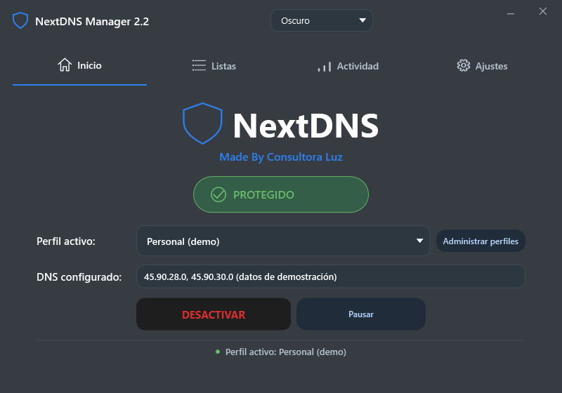
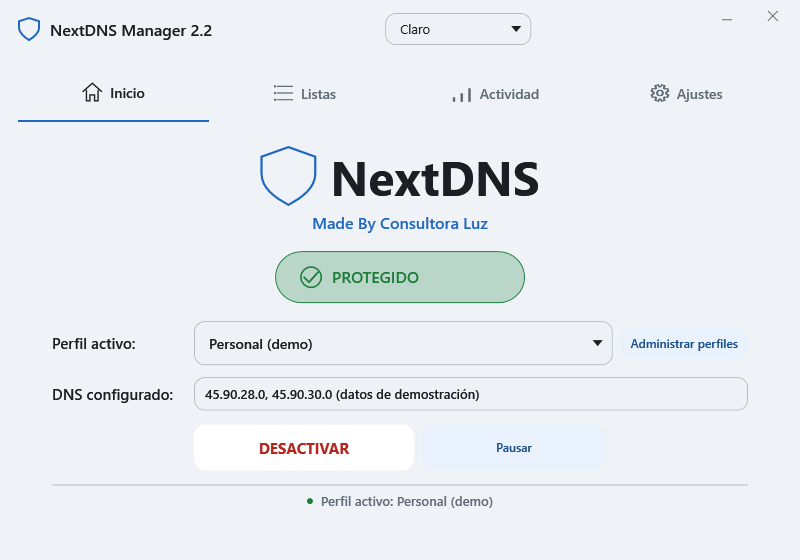

# NextDNS Manager para Windows

[Español](README.md) · [English](README_EN.md)

[](https://github.com/agustinbracamonte/NextDNS-Manager-WPF/releases/latest) [](https://github.com/agustinbracamonte/NextDNS-Manager-WPF/releases/latest) [](LICENSE)

**Administrá NextDNS desde Windows con una interfaz nativa, perfiles locales y herramientas para tu cuenta.**

[Descargar instalador](https://github.com/agustinbracamonte/NextDNS-Manager-WPF/releases/latest) · [Ver cambios](https://github.com/agustinbracamonte/NextDNS-Manager-WPF/releases) · [Reportar un problema](https://github.com/agustinbracamonte/NextDNS-Manager-WPF/issues) · [Preguntar o compartir ideas](https://github.com/agustinbracamonte/NextDNS-Manager-WPF/discussions)

> **Proyecto independiente y no oficial de NextDNS.** Administra la protección DNS de Windows mediante el CLI oficial de NextDNS. No implementa un resolver propio ni reemplaza la aplicación oficial.

| Inicio · modo oscuro | Inicio · modo claro |
| --- | --- |
|  |  |

*Capturas de la interfaz WPF con perfiles y datos de demostración. No muestran cuentas, claves API ni dispositivos reales. La transparencia del escritorio puede verse diferente en una captura.*

## Qué podés hacer

- **Controlar la protección:** activar, desactivar y pausar desde la ventana o la bandeja del sistema.
- **Administrar perfiles:** guardar perfiles locales y cambiar el perfil activo.
- **Gestionar listas:** consultar permitidos y bloqueados, agregar, activar o desactivar entradas e importar/exportar listas.
- **Revisar actividad:** consultar dominios por perfil y dispositivo, filtrar resultados y fechas, mostrar bloqueos y seguir consultas en vivo.
- **Editar opciones compatibles:** consultar y cambiar ajustes remotos disponibles en la API de NextDNS.
- **Personalizar y diagnosticar:** modos claro, oscuro y automático; interfaz en español, inglés, francés, portugués y alemán con selección manual o detección del idioma de Windows; registros de diagnóstico sanitizados y búsqueda de actualizaciones desde la aplicación.

Las funciones remotas requieren una clave API válida y dependen de los permisos, la configuración y la disponibilidad de la API de NextDNS. El control local de la protección no requiere esa clave.

## Instalar

1. Descargá el instalador x64 desde [la última versión publicada](https://github.com/agustinbracamonte/NextDNS-Manager-WPF/releases/latest).
2. Abrilo y completá el asistente. Windows solicitará permisos para instalar o actualizar el servicio auxiliar.
3. En **Ajustes → Perfiles locales**, agregá el nombre y el ID de seis caracteres de tu perfil NextDNS.
4. En **Inicio**, seleccioná el perfil y activá la protección.
5. Para usar **Listas**, **Actividad** y ajustes remotos, verificá tu clave API en **Ajustes**.

La instalación requiere Windows x64. El uso diario de la interfaz funciona con permisos normales; no hace falta abrir el programa como administrador. Si también usás la aplicación GUI oficial de NextDNS, no actives ambos clientes a la vez: administran la configuración DNS por separado.

El instalador no está firmado digitalmente, por lo que Windows puede mostrar una advertencia. La release incluye `SHA256SUMS.txt` para detectar errores o cambios en la descarga; un hash por sí solo no autentica quién publicó el archivo.

## Privacidad y seguridad

La clave API guardada se protege localmente con DPAPI de Windows para el usuario actual. La aplicación envía solicitudes a NextDNS para las funciones de API. La actividad que muestra proviene de los registros disponibles en NextDNS, no de un historial local independiente.

No publiques ni compartas claves API, perfiles privados, registros DNS ni diagnósticos sin revisarlos. Las capturas del README se generan en un modo de demostración aislado con datos ficticios.

Más detalles: [seguridad y privacidad](docs/SEGURIDAD_Y_PRIVACIDAD.md) · [permisos y servicio auxiliar](docs/PERMISOS_Y_SERVICIO.md) · [arquitectura](docs/ARQUITECTURA.md).

## Compilar y probar

Se necesitan Windows x64, .NET 10 SDK y PowerShell. Para crear el instalador, también se necesita Inno Setup compatible.

```powershell
.\scripts\Prepare-NextDNSCli.ps1
dotnet build .\NextDNSModernWPF.slnx -c Release
```

Para construir el instalador:

```powershell
.\scripts\Build-Installer.ps1
```

El proyecto fija la versión del CLI oficial y valida su checksum antes de compilar. Las pruebas automatizadas y sus límites están documentados en [compilación y pruebas](docs/COMPILACION_Y_PRUEBAS.md). No ejecutes las pruebas que cambian DNS en una PC de uso diario.

## Contribuir y pedir ayuda

Usá [Discussions](https://github.com/agustinbracamonte/NextDNS-Manager-WPF/discussions) para preguntas, ideas y experiencias de uso. Para errores reproducibles, abrí un [reporte de problema](https://github.com/agustinbracamonte/NextDNS-Manager-WPF/issues/new?template=bug_report.yml). Antes de adjuntar registros o capturas, eliminá claves, IDs de perfil, dominios privados, direcciones IP y nombres de dispositivos. Si querés difundir el proyecto, hay un [texto de presentación en español e inglés](docs/PRESENTACION_COMUNIDAD.md) para adaptar y compartir.

Las contribuciones siguen la guía de [CONTRIBUTING.md](CONTRIBUTING.md). La licencia MIT cubre el código propio de este proyecto; los componentes de terceros conservan sus licencias y avisos. Consultá [LICENSE](LICENSE) y [avisos de terceros](THIRD-PARTY-NOTICES.md).

## Alcance

NextDNS Manager es software independiente, no está afiliado ni respaldado por NextDNS. NextDNS y sus marcas pertenecen a sus respectivos titulares. El proyecto no contiene claves, perfiles, registros ni configuraciones personales.
