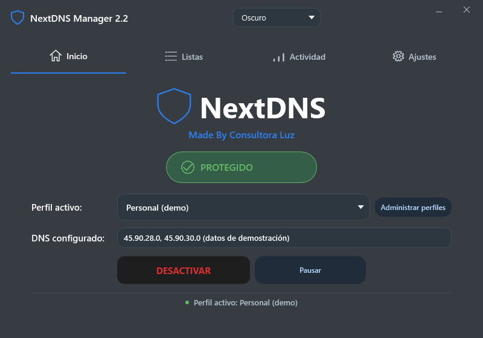
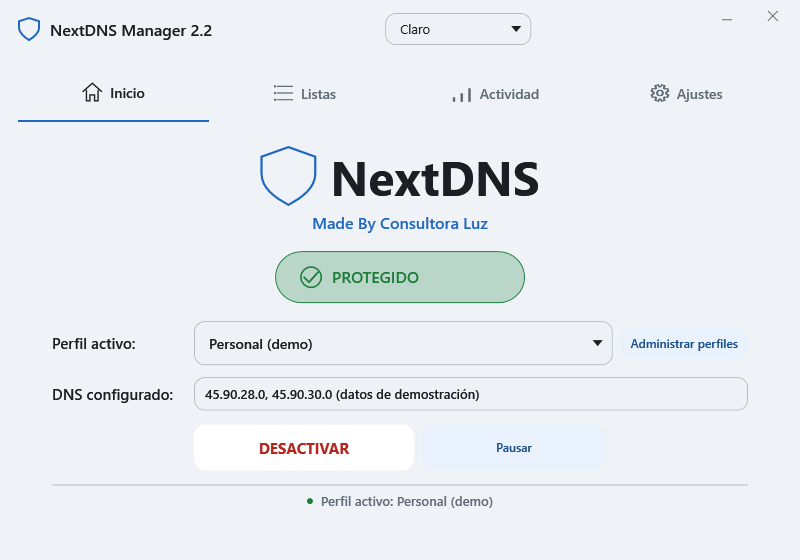

# NextDNS Manager for Windows

[English](README_EN.md) · [Español](README.md)

[](https://github.com/agustinbracamonte/NextDNS-Manager-WPF/releases/latest) [](https://github.com/agustinbracamonte/NextDNS-Manager-WPF/releases/latest) [](LICENSE)

**Manage NextDNS on Windows with a native desktop interface, local profiles, and account tools.**

[Download the installer](https://github.com/agustinbracamonte/NextDNS-Manager-WPF/releases/latest) · [Release notes](https://github.com/agustinbracamonte/NextDNS-Manager-WPF/releases) · [Report a bug](https://github.com/agustinbracamonte/NextDNS-Manager-WPF/issues) · [Ask a question or share an idea](https://github.com/agustinbracamonte/NextDNS-Manager-WPF/discussions)

> **Independent, unofficial project.** NextDNS Manager controls Windows DNS protection through the official NextDNS CLI. It does not implement its own DNS resolver or replace the official NextDNS GUI application.

| Home · dark mode | Home · light mode |
| --- | --- |
|  |  |

*Screenshots come from the WPF interface in an isolated demo mode using fictitious data. They contain no account, API key, or real device details. Desktop transparency may look different in a screenshot.*

## Features

- **Protection controls:** enable, disable, or pause from the main window or system tray.
- **Local profiles:** save profiles and switch the active profile.
- **Allow/block lists:** view, add, enable, disable, import, and export entries.
- **DNS activity:** inspect queries by profile or device, filter by domain, result, or local date and time, and follow live activity.
- **Remote settings:** read and edit supported options exposed by the NextDNS API.
- **Appearance and diagnostics:** automatic, light, and dark themes; Spanish, English, French, Portuguese, and German with manual selection or Windows language detection; sanitized diagnostic logs; and in-app update checks.

Remote features require a valid NextDNS API key and depend on the account's permissions, configuration, and API availability. Local protection controls do not require an API key.

## Install

1. Download the x64 installer from the [latest GitHub release](https://github.com/agustinbracamonte/NextDNS-Manager-WPF/releases/latest).
2. Run it and complete setup. Windows asks for administrator permission to install or update the helper service.
3. In **Settings → Local profiles**, add a name and the six-character ID from your NextDNS profile.
4. Select the profile on **Home** and enable protection.
5. To use **Lists**, **Activity**, and remote settings, verify your API key in **Settings**.

Windows x64 is required. Normal daily use runs with standard user permissions; the interface does not need to be launched as administrator. If the official NextDNS GUI is also installed, do not enable both clients at once: they manage DNS configuration separately.

The installer is not digitally signed, so Windows may show a warning. Releases include `SHA256SUMS.txt` to detect download errors or changes. A checksum alone does not authenticate the publisher.

## Privacy and security

The saved API key is protected locally with Windows DPAPI for the current user. API features send requests to NextDNS. Activity shown in the app comes from logs available through NextDNS; it is not a separate local query history.

Do not publish API keys, private profile IDs, DNS logs, or diagnostic files without reviewing and sanitizing them. README screenshots are generated in an isolated demo mode with fictitious data.

Read more: [security and privacy](docs/SEGURIDAD_Y_PRIVACIDAD.md) · [helper service and permissions](docs/PERMISOS_Y_SERVICIO.md) · [architecture](docs/ARQUITECTURA.md) · [build and tests](docs/COMPILACION_Y_PRUEBAS.md).

## Build

Requirements: Windows x64, .NET 10 SDK, and PowerShell. Inno Setup is also required to create the installer.

```powershell
.\scripts\Prepare-NextDNSCli.ps1
dotnet build .\NextDNSModernWPF.slnx -c Release
.\scripts\Build-Installer.ps1
```

The project pins the official CLI version and verifies its checksum before building. Read [build and test instructions](docs/COMPILACION_Y_PRUEBAS.md) before running tests that change system DNS; do not use those tests on a daily-use PC.

## Community and contributions

Use [GitHub Discussions](https://github.com/agustinbracamonte/NextDNS-Manager-WPF/discussions) for questions, ideas, and user feedback. Open a [bug report](https://github.com/agustinbracamonte/NextDNS-Manager-WPF/issues/new?template=bug_report.yml) for reproducible problems. Remove API keys, profile IDs, private domains, IP addresses, and device names before sharing logs or screenshots. A [Spanish and English project blurb](docs/PRESENTACION_COMUNIDAD.md) is available to adapt and share.

See [CONTRIBUTING.md](CONTRIBUTING.md) for contribution guidelines. The MIT license covers this project's original code; third-party components keep their own licenses and notices. See [LICENSE](LICENSE) and [third-party notices](THIRD-PARTY-NOTICES.md).

## Project scope

NextDNS Manager is independent software and is not affiliated with or endorsed by NextDNS. NextDNS and its marks belong to their respective owners. This repository contains no user API keys, profiles, DNS logs, or personal configuration.
