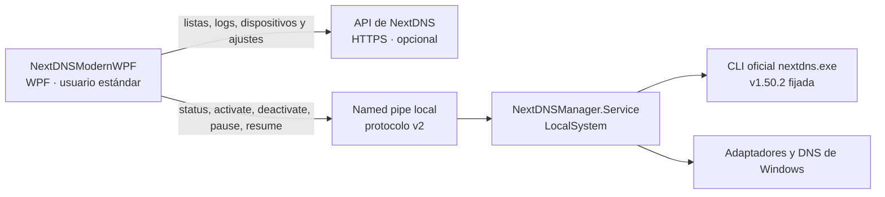

# Arquitectura

## Vista general

La interfaz y la API remota son componentes separados. La clave API se usa directamente desde la aplicación WPF para llamadas HTTPS a `api.nextdns.io`; no pasa por el servicio LocalSystem. El broker solo recibe operaciones locales del protocolo, valida las solicitudes y administra el CLI y la configuración DNS de Windows.

## Proyectos y directorios

| Ruta | Responsabilidad |
| --- | --- |
| `NextDNSModernWPF/` | Ventana WPF, tema, bandeja, perfiles locales, API de NextDNS, diagnósticos y actualización. |
| `NextDNSManager.Service/` | Servicio Windows LocalSystem, servidor named pipe, cambios/restauración DNS, ejecución del CLI y estado persistente del broker. |
| `Shared/` | Protocolo entre UI y servicio, coordinación de cambios de perfil, pausa temporal, diagnóstico y lectura de red reutilizable. |
| `installer/` | Definición Inno Setup, recursos del asistente y recuperación/limpieza del servicio instalado. |
| `scripts/` | Descarga verificada del CLI, publicación del instalador, artwork y verificación del árbol de instalación. |
| `tests/` | Probes de consola para el broker, API, lifecycle de WPF y actualizador. |
| `docs/` | Guías operativas, seguridad, pruebas, arquitectura y referencias visuales. |

La solución `NextDNSModernWPF.slnx` contiene el proyecto WPF; el servicio y los probes también pueden compilarse desde sus `.csproj`.

## Inicio, bandeja y ventana

`App.xaml.cs` crea una sola instancia por sesión, configura el inicio en bandeja para instalaciones registradas y crea `MainWindow`. La X oculta la ventana; el comando de bandeja **Salir** o `Ctrl+Q` cierra el proceso. El estado de protección pertenece al servicio, por lo que ocultar o cerrar la ventana no lo desactiva.

`MainWindow.xaml` describe las cuatro pestañas: Inicio, Listas, Actividad y Ajustes. El código de ventana está separado en parciales por área (`MainWindow.Api.cs`, `MainWindow.Network.cs`, `MainWindow.Pause.cs`, `MainWindow.ComboBox.cs`, `MainWindow.ActivityDateFilters.cs` y otros). Los temas claro y oscuro están en `Themes/`; `ThemeManager` agrega el modo automático.

La ventana inicia alrededor de 800×560 DIP y limita su tamaño a la zona útil del monitor. Los `ScrollViewer` mantienen accesible el contenido en áreas reducidas. En Windows 11 build 22621 o superior, `MainWindow.Backdrop.cs` solicita el backdrop DWM; si la operación no está disponible usa una superficie opaca de respaldo. En sistemas anteriores se conserva la ventana layered/translúcida y no se promete el mismo desenfoque.

## Perfiles locales

Los perfiles locales son pares de nombre e ID NextDNS de seis caracteres hexadecimales. Se guardan en `%APPDATA%\NextDNSManager\profiles.json`. No contienen la clave API. El botón de Inicio **Administrar perfiles** lleva al formulario de Ajustes. Al agregar un perfil se valida el nombre, formato del ID y duplicados; guardar no selecciona ni activa el nuevo perfil.

El selector Inicio decide qué ID se usa al activar el servicio. La lista de perfiles en Ajustes es local; los selectores de Listas y Actividad se alimentan con perfiles devueltos por la API de NextDNS.

## Broker, protocolo y DNS

El instalador registra `NextDNSManagerBroker` como servicio LocalSystem. La aplicación de usuario envía mensajes JSON por `NextDNSManager.Control.v2`. `Shared/BrokerProtocol.cs` limita cada mensaje a 4096 bytes, una sola línea JSON por conexión, profundidad acotada y sin propiedades desconocidas ni duplicadas. Las operaciones son `status`, `activate`, `deactivate`, `pause` y `resume`.

El cliente valida la identidad del proceso y servicio que posee la named pipe antes de enviar una solicitud. El servidor aplica ACL, comprueba SID/sesión interactiva, valida la versión y el perfil y serializa las operaciones.

`NextDnsEngine` coordina la instalación/verificación del CLI y el DNS de los adaptadores. `DnsConfiguration` conserva una copia de la configuración IPv4/IPv6 antes de sustituirla y la restaura al desactivar; los cambios de perfil se transaccionan y se pueden recuperar si la operación no termina. El servicio conserva la intención/pausa para reconciliar al iniciarse y al reanudar Windows. El CLI se instala como componente independiente y no se reinstala en cada activación.

## API de NextDNS

`NextDnsApiClient` usa un `HttpClient` cuyo host base está fijado a `https://api.nextdns.io/`. La clave viaja en `X-Api-Key` por HTTPS, no en la URL. El cliente incluye:

- perfiles y listas allowlist/denylist;
- agregar, actualizar, borrar y consultar entradas;
- importar en bloque con validación y resultados parciales;
- dispositivos de Analytics, páginas de logs y stream SSE;
- lectura y actualización de los ajustes que expone la interfaz.

La UI ofrece lectura/escritura de listas, importación/exportación con previsualización, Actividad y toggles de logs, privacidad de IP/dominio y página de bloqueo. No implementa en pantalla todas las operaciones que aparecen como métodos en el cliente API.

La consulta de logs usa páginas de 100 elementos; Actividad conserva hasta 1000 elementos en memoria y el SSE retiene hasta 2000 IDs recientes para deduplicación. El stream se cancela al cambiar de perfil, filtros, credencial, visibilidad o al cerrar la ventana. Los filtros fecha/hora se eligen en hora local, se convierten a UTC y se entregan como límites de consulta; el límite Hasta se representa como exclusivo. El modo en vivo no admite límites de fecha.

## Instalación y actualización

`Build-Installer.ps1` prepara el CLI fijado, publica la aplicación y el servicio como `win-x64` autocontenidos, genera un manifiesto SHA-256 y compila `installer/NextDNSManager.iss`. El instalador verifica archivos, comprueba que la aplicación no esté ejecutándose y registra el servicio auxiliar.

`UpdateChecker` consulta el endpoint de releases latest de GitHub y solo informa versiones estables mayores a la instalada. `UpdateInstaller` valida la release/assets permitidos, tamaño y SHA-256; la ejecución requiere interacción explícita y un helper limitado. La comprobación automática no descarga ni ejecuta el instalador.

## Estado local relevante

| Estado | Ubicación comprobada en el código |
| --- | --- |
| Perfiles locales | `%APPDATA%\NextDNSManager\profiles.json` |
| Clave API protegida | `%LOCALAPPDATA%\NextDNS Manager\api-key.dpapi` |
| Logs de la aplicación | `%LOCALAPPDATA%\NextDNS Manager\Logs\` |
| Configuración del broker y snapshots DNS | Registro `HKLM`, ramas usadas por `BrokerPolicy` y `DnsConfiguration` |
| Instalación del manager | `%ProgramFiles%\NextDNS Manager` |

El servicio y la instalación de la copia CLI son propiedad del Manager solo si la política de instalación verifica sus rutas/hash y registra dicha propiedad. La desinstalación evita retirar servicios ajenos.
