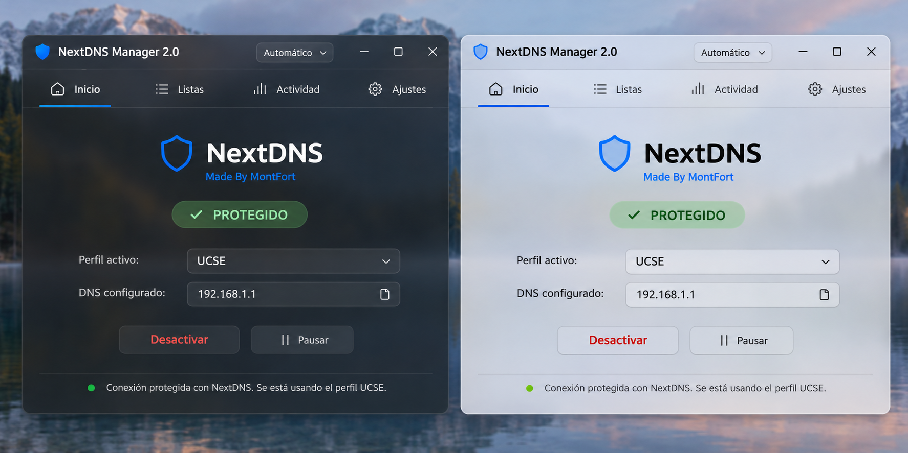
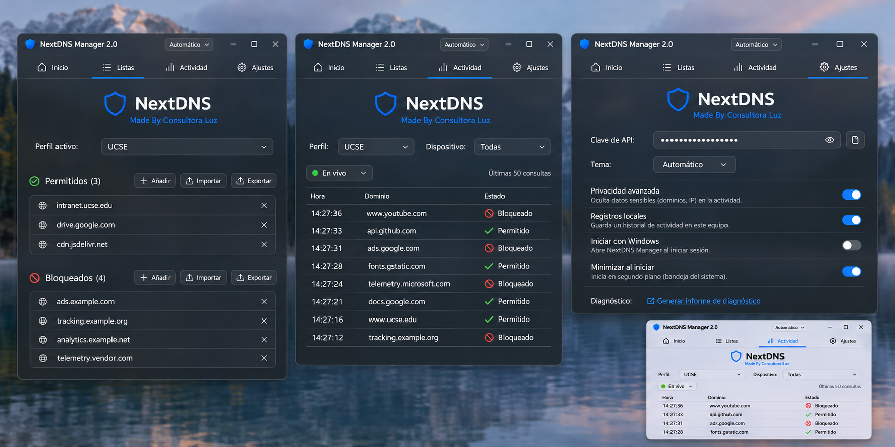

# Referencias visuales

Las imágenes siguientes son **maquetas históricas aprobadas durante el diseño de 2.0**, incluidas para conservar la referencia de composición, color, navegación y escalas. No son capturas de la aplicación actual ni una especificación de funciones. Se copiaron a este repositorio sin recortar, redimensionar ni recomprimir; sus SHA-256 coinciden con los archivos de origen.

## Inicio, claro y oscuro

Esta maqueta corresponde a Inicio. Algunos textos de marca y datos de perfil visibles pertenecen a una iteración anterior o son ilustrativos; no representan datos cargados por la aplicación.

## Listas, Actividad y Ajustes

Los elementos que aparecen aquí para privacidad, registros locales, inicio y minimizar son conceptos visuales de la propuesta. No describen necesariamente opciones existentes ni deben usarse para inferir qué datos se guardan o qué operaciones admite la API.

## Decisiones vigentes

- El escudo y la firma **Made By Consultora Luz** aparecen solo en **Inicio**. Se quitaron de Listas, Actividad y Ajustes después de aprobarse estas maquetas.
- La referencia se conserva como antecedente visual; la interfaz real y sus handlers XAML son la fuente de verdad para disponibilidad, estado y comportamiento de los controles.
- Listas administra las allowlist y denylist remotas del perfil API. Cada lista tiene su propio campo para agregar y acciones de importar/exportar. Las entradas existentes se omiten durante la importación para conservar su estado.
- Actividad muestra registros DNS devueltos por NextDNS. No es un historial local de consultas. Los filtros de fecha/hora se eligen en hora local y se convierten a UTC; **Hasta** es el límite exclusivo.
- Ajustes contiene solamente controles conectados a operaciones implementadas: tema, opciones locales de activación, perfiles locales, clave API, ajustes remotos soportados y diagnóstico.

## Integridad de las copias

| Archivo | SHA-256 |
| --- | --- |
| `exec-6332abc7-0f26-49ff-9020-c8ed4373e4d2.png` | `940bc075053470644332e0a6a5c3b1b6f19ef9ad2ae2c5791f570b3b5c4fdbfa` |
| `exec-e96a4325-43c4-4457-adb1-8c48c2be1657.png` | `bf1f9180ddca8864ce4b88239c33696082c7d17ba732de4ed355016cf450582c` |
